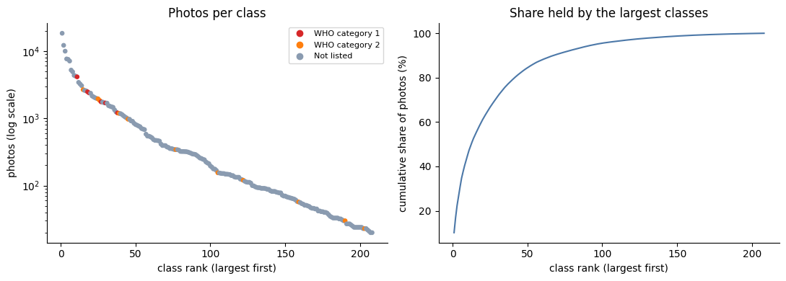
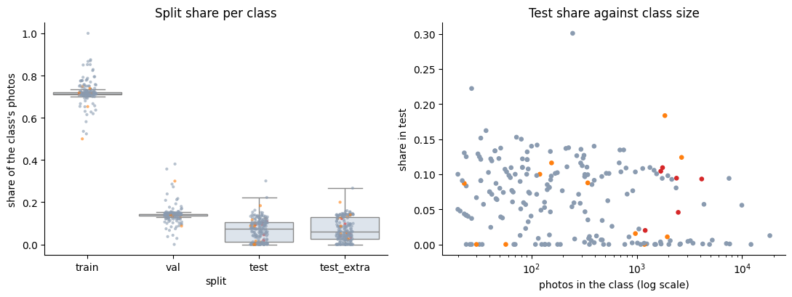
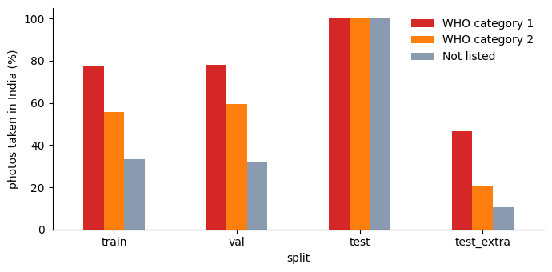
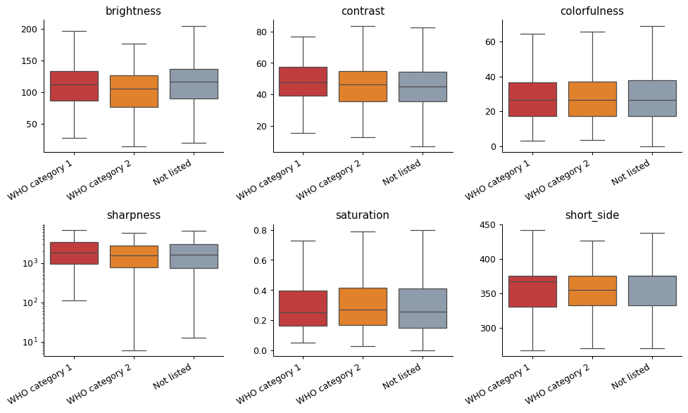
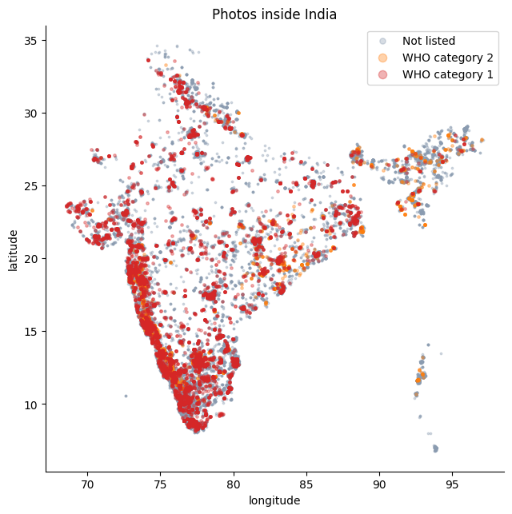
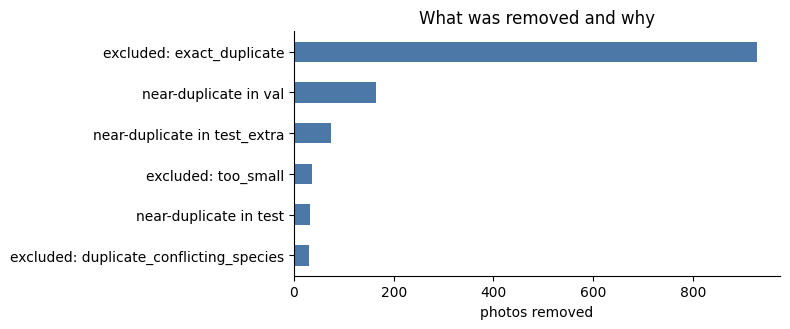
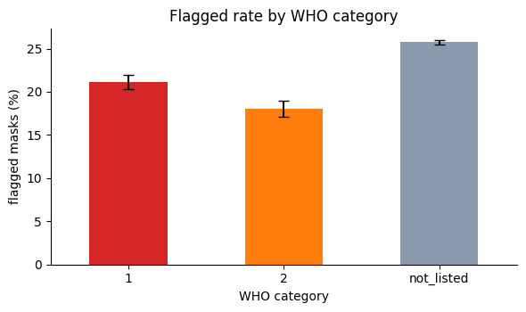

# Milestone 2: Dataset Preparation

Project: SerpentGuard AI, offline snake segmentation, classification and safety support<br>
Team: Group 5, DS and AI Lab Project. Team lead Jayesh Bansal; members Vikas, Puneet Bajaj and Manas Rastogi<br>
Date: 29 October 2026

## Summary

We built our dataset from iNaturalist research-grade observations: every photo, from anywhere in the world, of the 289 snake species recorded in India. After cleaning and duplicate removal, it holds **181,231 photos**: 180,575 in **208 classes** (species with at least 20 photos), plus 656 photos of 81 rarer species kept aside to test the "unknown" answer. Photos are split by photographer, so no photographer, observation or identical image appears in more than one of training, validation and test. The test set uses only photos taken in India and uploaded from 2022 onward.

| Item | Value |
|---|---|
| Source | iNaturalist research-grade observations, built 24 October 2026 |
| Species recorded in India | 289 |
| Photos in the final dataset | 181,231 (95,787 observations, 25,041 photographers) |
| Classes | 208: 68 tier-1 classes (at least 400 photos), 140 tier-2 classes (20 to 399) |
| WHO medically important classes | 17 (6 Category 1, 11 Category 2) |
| Unknown pool | 81 species, 656 photos, never used for training |
| Split (photos) | train 129,241 · validation 25,639 · test 7,305 · test_extra 18,390 |
| Processed dataset | Private Kaggle dataset `puneetbajajiitm/serpentguard-indian-snakes-processed` (section 7) |
| Rebuild | Notebooks 01 to 04 in [`notebooks/`](../../notebooks/README.md) |
| Presentation | [`SerpentGuard_AI_Milestone2_Dataset_Presentation.pdf`](SerpentGuard_AI_Milestone2_Dataset_Presentation.pdf) |

## 1. Dataset selected

### 1.1 Choice of source

iNaturalist is the main source. Members of the public upload photos of animals they see, and other users identify the species. An observation becomes **research grade** when at least two people have identified it and more than two-thirds of them agree on the species. We use that community identification as the label.

We chose it for three reasons:

1. It covers Indian snakes far better than any other public image source we found: 36,557 research-grade observations in India across 289 species on 24 October 2026.
2. Each photo comes with an observer, a date, a location and a licence, which we need for grouped splits and for licence records.
3. The released global model we compare against (Bolon et al. 2022) was trained mostly on iNaturalist data from before 2022, so photos uploaded later give a fair test.

### 1.2 Sources considered

| Source | What it offers | Decision for this milestone |
|---|---|---|
| iNaturalist research-grade observations | Species labels, metadata and licence per photo for every Indian species | **Used** (all of section 2 onward) |
| India Biodiversity Portal (via GBIF) | About 1,800 CC BY photos of 180 Indian species | Not included: the portal answers scripted downloads with HTTP 403 |
| SnakeCLEF 2021 (global model's training data) | 2,904 Indian photos; 1,742 are iNaturalist copies, about 1,160 come from HerpMapper and Flickr | Deferred: attaching its 66 GB Kaggle mirror stops Kaggle kernels before they start; we will fetch only the needed files later |
| SnakeCLEF 2023 Kaggle mirror | 4,989 Indian photos of 146 species | Not used: all are iNaturalist copies, already in our data |
| Kaggle sets scraped from Google, blogs or Facebook (for example "Snake Dataset-India", "Giant Snake Data") | Extra photos, often venomous/non-venomous labels only | Not used: unclear copyright, no verified species labels, and a high risk of duplicating our test photos |
| Manna et al. 2026, OSF folder | 793 photos from Indian emergency departments | Not used: no species labels and no stated reuse terms. We may ask the authors for labels to build a real-world test set |
| Open Images V7, class `Snake` | Boxes and masks around generic snakes, no species | Planned for Milestone 3 to supervise the segmentation head |

### 1.3 Change from Milestone 1

The Milestone 1 plan used 27 species with at least 200 Creative Commons observations in India. The TA's review found that too narrow, since India has roughly 300 to 400 snake species. We widened the dataset in two ways:

- We include photos from outside India of species recorded in India. That brings in species that are rare in Indian records, such as the king cobra, the monocled cobra and the banded krait, all WHO-listed. Test photos stay Indian.
- We include photos under every licence and record each photo's licence (section 2.2).

The 27 Milestone 1 species are all present and are flagged as `m1_core27` in the metadata.

## 2. Source, licence and usage

### 2.1 How the raw data was collected

| Step | Detail |
|---|---|
| Species list | iNaturalist API `observations/species_counts`, place 6681 (India), taxon 85553 (snakes), research grade only. Queries use taxon ids, never names: a name search for "Naja naja" returned a damselfly |
| Observations | Every research-grade observation of each species, worldwide, paged by observation id |
| Photos | iNaturalist's `medium` size (at most 500 px on the long side). Creative Commons photos come from the iNaturalist open-data bucket; all-rights-reserved photos come from iNaturalist's own server, throttled to 4.5 GB per hour |
| Run | One Kaggle notebook, 150 minutes, 182,497 photos, 0 failed downloads, 24.5 GB |
| Checks | 30 random photos re-downloaded from Kaggle matched their SHA-1 and size (30/30); for 8 sampled species the observation count equalled iNaturalist's live total |

### 2.2 Licences

Each photo keeps the licence its photographer chose. The licence and the photographer's attribution are stored for every photo in `metadata.csv`.


| Licence | Photos | Share |
|---|---:|---:|
| CC BY-NC | 101,308 | 56% |
| All rights reserved | 56,662 | 31% |
| CC BY | 14,964 | 8% |
| CC BY-NC-ND | 2,902 | 2% |
| CC BY-NC-SA | 2,628 | 1% |
| CC0 | 1,471 | 1% |
| CC BY-SA | 1,185 | 1% |
| CC BY-ND | 111 | under 1% |

How we use the data:

- The datasets are **private** on Kaggle, shared only with team members and the course staff, and used only for this non-commercial course project.
- Images are never committed to this public repository. The repository holds code, class tables and reports.
- 69% of photos carry a Creative Commons licence. The `cc_licensed` column marks them, so a Creative Commons-only subset (124,569 photos) can be selected in one line if required.
- The WHO medical-importance labels come from WHO SEARO (2016), *Guidelines for the Management of Snakebites*, 2nd edition, India section, PDF pages 86 and 87.

## 3. Size, classes and metadata

### 3.1 From raw photos to classes

| Stage | Photos | Notes |
|---|---:|---|
| Raw download | 182,497 | 289 species, 96,187 observations |
| Removed: exact duplicates | 928 | same image bytes (SHA-1) more than once; one copy kept |
| Removed: duplicates with conflicting species | 30 | same image under two species; all copies removed |
| Removed: too small | 36 | under 5 KB, or shorter side under 100 px |
| **Clean** | **181,503** | |
| Removed: near-duplicates across splits | 272 | a validation or test photo whose perceptual hash matches an earlier split (164 validation, 33 test, 75 test_extra) |
| **Final** | **181,231** | |
| In the 208 classes | 180,575 | species with at least 20 clean photos |
| Unknown pool | 656 | 81 species with fewer than 20 photos |

### 3.2 Classes

A class is one species. Each class has four labels: species, genus (70 genera), family (iNaturalist taxonomy) and WHO category for India.

| Tier | Rule | Classes | Photos | Intended use |
|---|---|---:|---:|---|
| Tier 1 | at least 400 photos | 68 | 162,770 | full species classification |
| Tier 2 | 20 to 399 photos | 140 | 17,805 | few-shot classification, genus and danger fallback |
| Unknown pool | under 20 photos | 81 species | 656 | testing the "unknown" answer |


The data is long-tailed. The largest class, the Brahminy blind snake (*Indotyphlops braminus*), has 18,340 photos, many of them from outside India because the species has spread worldwide. Tier-2 classes average 127 photos.

**WHO medically important classes (17):**

| Species | WHO category (India) | Tier | Train | Val | Test | Test extra |
|---|---|---|---:|---:|---:|---:|
| *Naja naja*, spectacled cobra | 1 | 1 | 2,955 | 586 | 385 | 204 |
| *Craspedocephalus malabaricus*, Malabar pit viper | 2 | 1 | 1,892 | 377 | 330 | 62 |
| *Echis carinatus*, saw-scaled viper | 1 | 1 | 1,766 | 354 | 113 | 240 |
| *Daboia russelii*, Russell's viper | 1 | 1 | 1,704 | 338 | 225 | 116 |
| *Bungarus fasciatus*, banded krait | 2 | 1 | 1,392 | 277 | 21 | 257 |
| *Craspedocephalus gramineus*, bamboo pit viper | 2 | 1 | 1,206 | 238 | 339 | 64 |
| *Bungarus caeruleus*, common krait | 1 | 1 | 1,253 | 251 | 192 | 59 |
| *Hypnale hypnale*, hump-nosed pit viper | 1 | 1 | 1,206 | 241 | 176 | 65 |
| *Naja kaouthia*, monocled cobra | 1 | 1 | 858 | 172 | 24 | 147 |
| *Macrovipera lebetinus*, Levantine viper | 2 | 1 | 883 | 151 | 0 | 147 |
| *Ophiophagus hannah*, king cobra | 2 | 1 | 692 | 138 | 15 | 124 |
| *Trimeresurus erythrurus*, red-tailed pit viper | 2 | 2 | 244 | 49 | 30 | 19 |
| *Ophiophagus kaalinga*, Western Ghats king cobra | 2 | 2 | 111 | 22 | 18 | 4 |
| *Bungarus niger*, black krait | 2 | 2 | 86 | 16 | 12 | 6 |
| *Naja oxiana*, Oxus cobra | 2 | 2 | 41 | 8 | 0 | 8 |
| *Bungarus walli*, Wall's krait | 2 | 2 | 15 | 9 | 0 | 6 |
| *Bungarus sindanus*, Sind krait | 2 | 2 | 17 | 2 | 2 | 2 |

*Ophiophagus kaalinga* was split from *O. hannah* in 2024, after the WHO guideline, so it takes the king cobra's Category 2. The full table for all 208 classes is [`data/classes.csv`](../../data/classes.csv).

### 3.3 Image characteristics

| Property | Value |
|---|---|
| Format | JPEG, RGB |
| Size | long side 500 px for 99.7% of photos; median 500 × 375 px; shorter side at least 100 px |
| File size | median 125 KB; 24.4 GB in total |
| Photos per observation | 1.89 on average |
| Taken in India | 37.7% of photos |
| Observation dates | 1968 to 2026; 87% from 2020 onward |
| Obscured coordinates | 18.2% of photos (iNaturalist hides the exact location of sensitive species and of observers who ask) |

### 3.4 Metadata

`metadata.csv` has one row per photo:

| Column | Meaning |
|---|---|
| `path` | location inside the processed dataset, `<split>/<species>/<file>.jpg` |
| `split` | train, val, test, test_extra or unknown_pool |
| `species`, `genus`, `family` | labels |
| `who_category` | 1, 2 or not_listed (WHO SEARO 2016, India) |
| `tier`, `m1_core27` | class tier, and whether the species was in the Milestone 1 list |
| `obs_id`, `photo_id`, `photo_position` | iNaturalist observation, photo, and order within the observation |
| `observer_id` | iNaturalist user id, used for grouping |
| `observed_on`, `created_at` | date taken and date uploaded |
| `in_india`, `latitude`, `longitude`, `obscured` | place information |
| `license`, `cc_licensed`, `attribution`, `url` | licence and credit for each photo |
| `width`, `height`, `bytes`, `sha1`, `phash` | image size and fingerprints used for deduplication |

### 3.5 Distribution of key attributes

| Attribute | Distribution (photos in the 208 classes, 180,575) |
|---|---|
| Family | Colubridae 91,152 · Viperidae 22,624 · Typhlopidae 18,898 · Elapidae 18,528 · Pythonidae 9,874 · Psammodynastidae 7,086 · 7 smaller families 12,413 |
| WHO category (India) | Category 1: 13,630 (7.5%) · Category 2: 9,332 (5.2%) · not listed: 157,613 (87.3%) |
| Where taken | India 37.7% · outside India 62.3% (all splits; the test set is India only) |
| Year observed (all 181,231 photos) | up to 2015: 8,214 · 2016 to 2019: 15,195 · 2020 to 2021: 20,636 · 2022 to 2023: 38,268 · 2024 to 2026: 98,918 |
| Photo position | 52.8% are the first photo of their observation; the rest are later photos, which more often show habitat, a hand or a detail |

The class distribution is long-tailed (section 3.2), so the planned training uses class-balanced sampling or loss weighting, and the headline metric is macro-F1, which weights every class equally.

### 3.6 Data quality

| Check | What we found | How it is handled |
|---|---|---|
| Missing values | Every photo has its species, licence, attribution, observer, dates, size and checksum. Coordinates are missing for 1,488 photos (0.8%) and obscured by iNaturalist for 33,061 (18%) | Location is optional (only used by the planned state prior), so these photos stay |
| Inconsistent labels | 30 photos had identical bytes under two different species | Removed (section 3.1) |
| Taxonomic level | 8,578 photos were identified to a subspecies, for example *Echis carinatus carinatus* | Each species was queried by taxon id, which includes its subspecies, so they carry the species label; `record_taxon` keeps the original identification |
| Taxonomic changes | Renamed genera (*Xenochrophis* to *Fowlea*, *Trimeresurus* to *Craspedocephalus*) and the 2024 king cobra split | Labels follow iNaturalist's taxonomy on 24 October 2026, by taxon id |
| Duplicates | 928 exact duplicates; 272 near-duplicates across splits | Removed (sections 3.1 and 5) |
| Label noise | Research grade applies to the observation, not each photo. In the 500-photo segmentation pilot, roughly 2% of photos did not show a live snake (shed skins, another animal, footwear) | Kept for now; `photo_position` marks later photos; a stratified hand-check of 200 photos is planned for Milestone 3; mask quality flags keep non-snake photos out of mask training |
| Image quality | 36 photos too small or too low in resolution; every remaining photo decodes and matches its SHA-1 | Removed; verified during processing |

### 3.7 Is the dataset adequate?

- **Species classification:** adequate for the 68 tier-1 classes, which have at least 400 photos each (enough to fine-tune a pretrained backbone) and an Indian test set for 57 of them. The 140 tier-2 classes are too small for standard training, so the plan uses few-shot methods for them and falls back to genus and danger level.
- **Dangerous species:** 17 WHO-listed classes with 22,962 photos (12.7% of the classes' photos). Some have small Indian test sets (king cobra 15, banded krait 21, monocled cobra 24), so their results will carry wide bootstrap intervals and are also reported on `test_extra`.
- **Real-world conditions:** iNaturalist photos are mostly still, well-framed and taken in daylight by enthusiasts. Real use means hurried phone photos and video, at night and with partial views. Augmentation and the planned synthetic and re-filmed video clips address this gap, and an emergency-department photo set (Manna et al. 2026) would test it if the authors agree.
- **Segmentation:** there are no ground-truth snake masks, so masks come from SAM 2.1 pseudo-labels (section 9), with Open Images masks as a supplement.
- **Video:** there is no public species-labelled snake video, so video is used for evaluation only, through synthetic clips.

### 3.8 Augmentation, supplementary and synthetic data

- **Augmentation** (applied in the data loader during training, not stored): random resized crops, horizontal flips, small rotations, brightness and contrast changes, blur, JPEG compression and partial occlusion. We avoid colour or hue shifts strong enough to change banding or colour patterns, which are diagnostic for several lookalike pairs.
- **Supplementary data:** the HerpMapper and Flickr photos of Indian species from SnakeCLEF 2021 (about 1,160 Indian photos, to be fetched file by file), Open Images V7 snake masks for segmentation pretraining, and the Manna et al. 2026 emergency-department photos as a real-world test set if the authors grant labels and reuse.
- **Synthetic data:** none in this milestone. The synthetic video clips from the Milestone 1 plan (camera motion, blur, low light and occlusion applied to test photos, with every parameter seeded and logged) will be generated for evaluation only, from test photos, in Milestone 5. The SAM masks are pseudo-labels on real photos, not synthetic images.

### 3.9 Labels, annotations and how the datasets connect

| Label or annotation | Source | Quality check |
|---|---|---|
| Species | iNaturalist research grade: at least two identifiers, more than two-thirds agreeing | Conflicting duplicates removed; subspecies rolled up by taxon id; planned 200-photo hand-check |
| Genus and family | iNaturalist taxonomy of each species | Taken from the taxonomy tree, not typed by hand |
| WHO category | WHO SEARO 2016, India list | 17 of the 20 listed species are classes. *Naja sagittifera* (Andaman cobra) has only 7 photos and sits in the unknown pool; *Trimeresurus albolabris* and *T. purpureomaculatus* have no research-grade photos under those names, likely because of later taxonomic splits. *Ophiophagus kaalinga* inherits the king cobra's category |
| Snake mask | Grounding DINO plus SAM 2.1 pseudo-labels, training photos only | Quality flags; flagged masks go to a hand review |

Every table shares one key. `metadata.csv` has one row per photo with its `path` and `photo_id`. A mask file has the same name as its photo. `classes.csv` maps each species to its `class_id`. The WHO category and taxonomy join on species. Masks are made only for training photos, so segmentation supervision never touches validation or test photos. Open Images is used only to pretrain the segmentation head and never enters the species splits.

## 4. Sample images

Two photos from the dataset show one of the lookalike pairs the model must separate: the spectacled cobra is WHO Category 1, and the oriental rat snake is not listed.

| Spectacled cobra (*Naja naja*) | Oriental rat snake (*Ptyas mucosa*) |
|---|---|
|  |  |
| © Chayant Gonsalves, CC BY, [iNaturalist 84964394](https://www.inaturalist.org/observations/84964394) | © Surabhi Srivastava, CC BY, [iNaturalist 212098553](https://www.inaturalist.org/observations/212098553) |

The grids below are random training photos (fixed seed), drawn only from photos whose licence allows sharing a resized copy with credit: CC0, CC BY, CC BY-SA, CC BY-NC and CC BY-NC-SA. Each grid has an `_attribution.csv` in `assets/` listing every tile's species, photographer, licence and source. Grids drawn from all photos, including all-rights-reserved ones, stay in the private Kaggle dataset (`figures/`).

**One photo per class** (row by row, largest class first; [credits and order](assets/grid_all_classes_attribution.csv)):


**WHO Category 1 and 2 species, four photos each** (one row per species; [credits and order](assets/grid_who_listed_attribution.csv)) and **Milestone 1 core species, four photos each** ([credits and order](assets/grid_core27_attribution.csv)):

| WHO-listed species (17 rows) | Milestone 1 core species (27 rows) |
|---|---|
|  |  |

A manual check of downloaded photos found the variety the model will face: snakes held in a hand, specimens beside a ruler, night photos with the snake small in the frame, and photographers' watermarks. Research grade applies to the observation, not to each photo, so a photo can show a shed skin or the habitat instead of the snake.

## 5. Cleaning and preprocessing

| Step | What it does | Why |
|---|---|---|
| Remove tiny files | drops photos under 5 KB or with a shorter side under 100 px | they carry too little detail for scale and pattern features |
| Remove conflicting duplicates | drops every copy of an image that appears under two species | the label cannot be trusted |
| Remove exact duplicates | keeps one copy of byte-identical photos, preferring the Indian one | one photo must not appear twice or in two splits |
| Remove near-duplicates across splits | drops a validation or test photo whose perceptual hash already appears in an earlier split | resized or recompressed copies would inflate test scores |
| Verify every file | checks each photo's SHA-1 against the download manifest | catches corruption between the download and the processed copy |
| Keep the original resolution | photos stay at iNaturalist's `medium` size | the encoders compared in Milestone 3 need different input sizes (224, 256 or 384 px), so resizing, normalisation and augmentation happen in each model's data loader |
| Attach labels | species, genus, family, WHO category, tier | the planned model has species, genus and danger heads |

The class, split and licence figures in this report come from `metadata.csv`. The exploratory analysis is in section 5.1 and the SAM segmentation preprocessing and multi-task data loader pipeline is in section 5.2.

### 5.1 Exploratory data analysis

#### 5.1.1 EDA and findings (Manas Rastogi)

The analysis is one notebook, [`Group 5 - 2026T3 - DSAI Lab.ipynb`](../../Group%205%20-%202026T3%20-%20DSAI%20Lab.ipynb), saved with its outputs so the charts show on GitHub. It also runs on Kaggle as `wreckermoon/group-5-2026t3-dsai-lab-eda`. It reads the three private datasets from section 7 (the processed photos, the split and exclusion tables, and the SAM masks), works through them in the order below, and finishes in about 10 minutes on a Kaggle GPU (the embedding step in 5.14 needs it). Every number in this section is computed by the notebook when it runs. Where earlier sections of this report quote a figure, the notebook recomputes it and prints PASS or FAIL: all 86 checks pass.

Counts, sizes, dates and licences use all 181,231 photos in `metadata.csv`. Anything that needs the pixels (brightness, sharpness, faces, fingerprints) uses a random sample of up to 30 photos per species, 6,784 photos from the 289 species (seed 42), because reading every file would take hours. Photos shown in the notebook are CC0 or CC BY (CC BY-NC when a class has none), each with the photographer's credit, and photos with a detected face are avoided.

**Questions we asked**

| # | Question | Why it matters for the model | Notebook section |
|---|---|---|---|
| 1 | Do the tables, the class file and the image files on disk agree? | A wrong label or a missing file breaks training without an error | 1 |
| 2 | How uneven are the classes, and how are the WHO categories spread? | Decides loss weighting, sampling and which metric to report | 2 |
| 3 | Are the splits balanced, is anything shared between them, and does test look like train? | A shared photographer or a near copy inflates the test score, and a shift between train and test lowers it | 3 |
| 4 | What sizes and shapes do the photos have? | Decides the input size and whether to crop or pad | 4 |
| 5 | How sharp, bright and colourful are the photos, and do they differ by danger level, split or year? | A difference between train and test is a distribution shift | 5 |
| 6 | Where, when, by whom and under which licence were the photos taken? | Location, season and photographer habits can be learned as shortcuts | 6 |
| 7 | Are dangerous species and their harmless lookalikes equally well covered? | The costliest mistake is a dangerous snake called harmless | 7 |
| 8 | What did cleaning remove, and how good are the snake masks? | Shows what the model never sees and which masks can supervise training | 7a, 7b |
| 9 | Which colour numbers should the model normalise with, and do the splits share them? | Mean and standard deviation must come from train only | 5.13 |
| 10 | Do val and test look like train in content, and are there copies or wrong labels the hash missed? | A split that is easy to tell apart, a hidden copy or a wrong label distorts the score | 5.14, 5.15 |
| 11 | How big is the snake in the frame, and how many photos have a visible problem? | Decides the input size and the cleaning rule | 5.16, 5.17 |
| 12 | Does the picture space follow taxonomy and the lookalike pairs, and does train cover the test photos? | Tells us where the model will confuse species and where a test score is noisy | 5.18, 5.19 |
| 13 | Do all files open, and in which format? | A PNG named `.jpg` or a grey photo breaks a loader | 5.20 |

**What stands out**

- **Test is not a smaller copy of train.** Every test photo was taken in India, against 37.6% of training photos; 55.8% of test photos are portrait against 40.7% in train; and 25.8% of test photos are WHO Category 1 or 2 against 12.6% in train.
- **Danger and country are linked in training only.** In train, 77.7% of Category 1 photos, 55.5% of Category 2 photos and 33.1% of not-listed photos were taken in India. A model can use an Indian-looking scene as a weak hint of danger, and that hint cannot help on an all-Indian test set.
- **Test classes come from few people.** 82 of the 180 classes with test photos have three photographers or fewer in `test`, and the ten smallest have one photo from one person.
- **Some near copies remain.** The splits share no photographer, observation, checksum or identical hash, but 19 photos in val, test and test_extra sit within 2 bits of a training photo's perceptual hash. Only exact matches were removed (section 3.1 of this report).
- **28 classes have no test photos**, three of them WHO-listed: *Macrovipera lebetinus*, *Naja oxiana* and *Bungarus walli*.
- **A quarter of the snake masks are flagged** for review (section 7b).

**1. Files and tables.** The metadata has 181,231 rows and 33 columns. The only missing values are the coordinates of 1,488 photos (0.8%), and every one of them is marked as obscured. No metadata row lacks an image file and no file lacks a row. `classes.csv` agrees with the metadata for every class and split, and every figure in `processing_report.json` equals the value recomputed from the tables.

**2. Labels.** The data is long-tailed (figure below). The largest class, *Indotyphlops braminus*, has 18,328 photos and the smallest has 20; the median class has 162. The 10 largest classes hold 45.0% of the class photos, and 13 classes are enough to cover half of them. The imbalance ratio between the largest and smallest class is 916, the Gini coefficient of class sizes is 0.76, and the effective number of classes (1 / sum of squared shares) is 32.8 out of 208. 80 classes have fewer than 100 photos. The 289 species fall into 14 families and 77 genera; 29 genera have a single species, so a genus head adds nothing for them. WHO Category 1 and 2 hold 7.5% and 5.2% of the class photos in 6 and 11 classes. The Milestone 1 core set (27 classes) has 77,044 photos, 42.7% of the class photos.



**3. Splits and leakage.** In the median class, 71.5% of the photos are in train, 14.2% in validation, 7.4% in test and 6.0% in test_extra. 28 classes have no photo in `test` (3 of them WHO-listed) and one class, *Wallaceophis gujaratensis*, has none in validation. The test rule (taken in India, uploaded from 1 January 2022) is broken by 0 of the 7,305 test photos. Between train, validation and test, the number of shared photographers, observations, SHA-1 checksums and perceptual hashes is 0 each. For information, `test` and `test_extra` share 122 photographers because both come from the same test fold, and the unknown pool shares 143 with train; neither counts as leakage. Beyond the split rule (the second part of notebook section 3, "Beyond the split rule"):

| Check | Finding |
|---|---|
| Near copies of a training photo (hash within 2 bits) | 13 in val, 1 in test, 5 in test_extra; 23, 1 and 11 within 4 bits |
| Photo shape | Landscape 57.2% of train, 42.4% of test; portrait 40.7% of train, 55.8% of test |
| Photographers per class | 3 of 208 classes have 5 or fewer training photographers; 82 of 180 have 3 or fewer test photographers |
| Several photos of one sighting | 67.9% of photos belong to an observation with more than one photo |
| Subspecies | 8,578 photos (4.7%) were identified to a subspecies, for example *Coelognathus helena helena* |





**4. Image sizes.** 99.7% of the photos have a long side of exactly 500 px, and the median photo is 500 × 375 px. 57.0% are landscape, 40.5% portrait and 2.5% square (aspect ratio within 2% of 1). The short side is under 224 px for 0.7% of the photos, under 256 px for 6.0% and under 320 px for 19.7%. Files have a median of 125 KB and a 99th percentile of 311 KB, but the largest is 26.2 MB: it is a GIF stored under a `.jpg` name. 536 photos have a non-JPEG address (GIF or PNG) and they take most of the highest bytes-per-pixel places. All photos together take 24.4 GB. The two image hosts (open-data bucket for CC photos, iNaturalist server for all-rights-reserved ones) serve photos of the same size and quality, so licence does not change what a photo looks like.

**5. Image quality (sample).** Across the sample the median sharpness (variance of the Laplacian) is 1,633, brightness 116 (of 255), contrast 44.9, colourfulness 26.5 and saturation 0.26. Photos of WHO Category 2 snakes are the darkest (median brightness 105.8 against 116.5 for not-listed species, p below 0.001), while sharpness does not differ clearly by danger level (1,846 for Category 1, 1,570 for Category 2, 1,634 for not-listed). By split, test photos are somewhat sharper than train (1,930 against 1,628, p = 0.04), and test_extra photos are darker (104), more colourful (29.8) and more saturated (0.33). With this many photos even a small shift gives a small p-value, so we read the medians. A face was detected in 0.1% of the sample. Recomputing the perceptual hash gave a value within 2 bits of the stored one for 100% of the sampled photos, and 14 near-duplicate pairs (distance 2 or less) appeared inside the sample, all of the same species and 13 of them in the same split. Measuring the sample took 11 s per 1,000 photos.



**5a. Deeper checks (notebook sections 5.13 to 5.20).** These use the sample from section 5 and, for 5.14 to 5.19, a DINOv2-small embedding of 3,390 photos (up to 8 training photos per species and every sampled val, test and test_extra photo).

| Section | What we found | What it means for training |
|---|---|---|
| 5.13 Colour | Train channel means are 0.456, 0.439, 0.375 and standard deviations 0.235, 0.224, 0.225, a little below the ImageNet values. val and test sit within 0.08 train standard deviations of train; `test_extra` is darker (up to 0.23 lower, in blue) | Normalise with the train numbers, not the ImageNet ones |
| 5.14 Embeddings | After the species average is removed, a classifier barely separates train from val (AUC 0.542), test (0.507) or test_extra (0.491), so the splits look alike in content. 14 photos have a photo from another photographer at cosine similarity 0.9 or more and 2 at 0.95 or more, one of them across val and test (similarity 1.000) | The splits are comparable in appearance; the hash misses a few copies, which the plan below removes |
| 5.15 Label issues | A simple classifier on the embeddings reaches 24.8% on photographers it has not seen, so it flags 66.6% of photos and is too weak to give a verdict. Of the flagged photos 15.2% have a guess in another WHO category and 12 have a label and guess that form a known lookalike pair | Use the ranked list only to choose photos for a hand check, never to drop photos automatically |
| 5.16 Snake size | The median snake is 64% of the photo's long side. At a 224 px input 6.8% of snakes are shorter than 64 px and 21.8% shorter than 100 px; at 384 px 1.4% and 5.3%. *Echis carinatus* (WHO Category 1) is the worst of the large classes, with 13.2% of 1,705 masks under 64 px | A bigger input or a crop to the snake box helps small snakes most |
| 5.17 Photo flags | 18.4% of sampled photos have at least one flag (dark 7.9%, odd shape 7.1%, low contrast 2.9%, grey 1.2%, blurry 0.9%, tiny 0.7%, overexposed 0.4%). Dropping dark, overexposed, blurry and tiny photos would remove 9.7%, unevenly (13.6% of Category 2, 6.1% of Category 1; 67% of *Boiga wallachi*) | Drop only the blurry and tiny photos; many species are photographed at night |
| 5.18 Species map | The nearest photo from another photographer is in the same genus for 37.5% of photos (3.1% by chance) and the same family for 64.6% (32.8% by chance). From the dangerous side, 6 of the 9 named lookalike partners are among the 5 nearest of 207 species. For only 1 of the 17 dangerous species is the closest harmless species one on our list; for the others it is a relative missing from the WHO list | A genus or family head is worth testing; check the close relatives of dangerous species too |
| 5.19 Coverage | The median similarity of a val, test or test_extra photo to its nearest training photo of the same species is 0.562, 0.569 and 0.574, so test is covered as well as val. The least covered species have only three test photos | A test score on those species is noisy rather than a sign of a gap |
| 5.20 Files | 6,765 of the 6,784 sampled files are RGB JPEGs. 18 are PNG files named `.jpg` (13 with an alpha channel) and one JPEG is greyscale. None has an EXIF rotation flag or more than one frame; 4,626 carry a colour profile | Convert every photo to RGB when loading |

**6. Where, when, who and licence.**

| Topic | What we found | What it means for training |
|---|---|---|
| Place | 37.7% of the photos are taken in India (37.6% of train, 37.2% of val, 12.7% of `test_extra`, all of `test`); 18.2% have obscured coordinates | Most training photos come from outside India, while the test set is all Indian |
| Time | 87.1% of the photos were taken in 2020 or later; the median gap between seeing and uploading is 2 days, 47.5% are uploaded within a day and 13.5% after more than a year; 1,920 upload times fall before the observed date (UTC against local date) | Photos taken in different years differ in colour and sharpness (section 5.8), so the year is a possible shortcut |
| Photographers | 25,041 photographers, a median of 2 photos each, 38.4% with a single photo; the Gini coefficient of photos per photographer is 0.72, the top 1% took 26.6% of the photos and the busiest took 2,189 | A few styles can dominate a class |
| Photographers per class | In the median class the top three photographers took 26.2% of the training photos; *Wallaceophis gujaratensis* has 24 photos from 2 people | A model can learn a photographer's style instead of the species; validation should be grouped by photographer |
| Licence | 68.7% of the photos are Creative Commons (124,569 photos); 24 classes have no CC0 or CC BY photo, and every class has at least one photo that may be shown | Public figures use CC photos only; the rest stay in the private datasets |



**7. Safety lookalikes.** We examined nine pairs that join a WHO-listed species with a harmless lookalike, plus two pairs where both snakes are dangerous (*Hypnale hypnale* with *Craspedocephalus malabaricus* and with *Echis carinatus*). The WHO category of each side is read from `classes.csv`, and the notebook checks that the dangerous side is Category 1 or 2 and the lookalike is not listed. All nine pairs have test photos on both sides, the smallest side having 70 photos, and every side has 30 sampled photos. The dangerous snake's photos are darker than its lookalike's in 8 of 9 pairs, and blurrier in 3 of 9. Only two differences are clear (p below 0.01), both between the common krait and a wolf snake, and in both the krait's photos are the sharper ones. The per-pair counts are saved as `lookalike_pairs.csv` in the notebook output.

**7a. Cleaning funnel.** The notebook rebuilds the table in section 3.1 from `splits.csv`, `excluded.csv` and `metadata.csv`: 182,497 raw photos, 928 exact duplicates, 30 duplicates with conflicting species, 36 files that are too small, 181,503 clean photos, 272 cross-split near-duplicates (164 validation, 75 `test_extra`, 33 test) and 181,231 in the final dataset. *Indotyphlops braminus* loses the most photos (117), and the largest share lost is 20.6% for *Platyceps josephi*, a small class. Among species with at least 50 raw photos no species loses more than 3.3%.



**7b. Snake masks.** The notebook read the masks dataset version that was attached when it ran: 129,241 masks for training photos from 208 classes (13 to 13,311 per class), 100% of the training photos. 32,312 masks (25.0%) are flagged for review: 21.2% of Category 1, 18.1% of Category 2 and 25.7% of not-listed photos. The detector found no snake in 3,932 photos (3.0%) and two snakes in 5,568 (4.3%), and hands or gloves were cut out of 5,843 masks (4.5%). The commonest flag reasons are a low detector score and a low fill of the box by the mask. *Ahaetulla borealis* has the highest share of photos with no snake found, 13.8%.



**What the analysis changes in our plan**

| Finding | What we do about it |
|---|---|
| Class sizes run from 20 to 18,328 photos | Class-balanced sampling or loss weighting; macro-F1 as the headline metric (section 3.5) |
| 6.0% of photos have a short side under 256 px, and 40.5% are portrait | Resize and pad instead of centre-cropping; compare 224, 256 and 384 px inputs in Milestone 3 |
| Test is 55.8% portrait against 40.7% in train | Include rotation and portrait crops in augmentation, and report validation scores on portrait photos separately |
| Test classes have few photographers (82 of 180 with three or fewer) | Bootstrap by photographer, not by photo, for every confidence interval in Milestone 5 |
| Danger level and India are linked in train (77.7% against 33.1%) but not in test | Also report validation results on the India-only part of validation, so the shift is visible before the test run |
| 19 photos in val, test and test_extra have a near copy in train | Drop them before the split is frozen; it is a one-line filter on the perceptual hash |
| A few photographers dominate some classes (top three: 26.2% of a typical class) | Strong colour, blur and crop augmentation; validation grouped by photographer |
| 25.0% of masks are flagged | Flagged masks stay out of mask training until the hand check in Milestone 3 |
| Lookalike pairs differ in photo counts and quality | Report the error rate in both directions for every pair (Milestone 5) |
| Train channel means and standard deviations differ a little from ImageNet's | Normalise with the train values from 5.13 |
| 6.8% of snakes are under 64 px at a 224 px input, 1.4% at 384 px | Compare 224 and 384 px, and try cropping to the snake box first |
| 18.4% of photos carry a flag, mostly dark or odd-shaped | Drop only blurry and tiny photos (1.7% of the sample); keep dark ones |
| A few photos have a near copy from another photographer that the hash missed (2 at similarity 0.95 or more) | Add an embedding-similarity check to the near-copy filter |
| The label finder is weak (24.8% accuracy) | Hand-check the top of its ranked list in Milestone 3; no automatic relabelling |
| 16 of 17 dangerous species have a close relative that is not on our list | Review those pairs for lookalike errors and report them as well |

### 5.2 Preprocessing, SAM segmentation pipeline and multi-task data loader (Vikas)

The preprocessing and model-ready data loading pipeline is implemented in [`notebooks/serpentguard_ai_m2_segmentation_preprocessing.ipynb`](../../notebooks/serpentguard_ai_m2_segmentation_preprocessing.ipynb). It integrates all three mounted project datasets (`serpentguard-m2-splits`, `serpentguard-indian-snakes-processed`, and `serpentguard-sam-masks`) into an end-to-end PyTorch pipeline for Milestone 3 model training.

#### 5.2.1 Why SAM segmentation outperforms rectangular bounding boxes
Standard object detection places an axis-aligned bounding box around the target. However, because snakes frequently coil diagonally, wrap around tree branches, or wind across terrain, an axis-aligned bounding box contains **60% to 85% background clutter** (dry leaves, soil, undergrowth, asphalt, rocks). Supervising models with raw bounding box crops forces the convolutional and attention heads to absorb substantial background noise. 

By leveraging precomputed Segment Anything Model (SAM 2.1) pixel masks from `serpentguard-sam-masks`, the pipeline isolates the snake's true biological boundaries (dorsal scales, keels, subcaudals, and head shapes) while handling complex background scenes.

#### 5.2.2 Configurable foreground preprocessing modes
The preprocessing engine supports three foreground enhancement modes:
1. **Soft-Dimming (`mode="soft_dim"`, default, `bg_alpha=0.20`)**: Retains 100% of foreground snake pixel intensity while dimming non-snake background pixels by 80% towards neutral ImageNet gray `(124, 116, 104)`. A Gaussian smoothing kernel ($\sigma=5$) softens mask edges so the transition does not introduce artificial high-frequency edge artifacts that a CNN might mistake for biological boundaries.
2. **Hard-Masking (`mode="hard_mask"`, `bg_alpha=0.0`)**: Completely suppresses all background pixels outside the SAM mask, replacing them with neutral gray.
3. **RGBM 4-Channel Input (`mode="rgbm_4ch"`)**: Retains the complete RGB image and appends the normalized SAM binary mask as a 4th input channel `(R, G, B, Mask)`. This allows dual-branch backbone architectures in Milestone 3 to dynamically cross-attend to foreground cues.

#### 5.2.3 Aspect-ratio-preserving letterbox resizing (`320×320`)
Naively stretching photos to standard square dimensions ($320\times320$) distorts snake body proportions, turning slender, elongated arboreal vine snakes (*Ahaetulla nasuta*) into thick-bodied terrestrial vipers (*Daboia russelii* or *Echis carinatus*).
To eliminate distortion:
- The pipeline computes the tight contour envelope of the SAM mask and adds a **+6% boundary padding** to safeguard sensitive tail tips and rostral scales.
- The crop is scaled along its longest dimension to 320 px using area interpolation (`cv2.INTER_AREA`), and the shorter dimension is centered with neutral gray letterbox padding.

#### 5.2.4 Image hygiene and EXIF orientation normalization
Field photographs from smartphones often embed rotation tags in EXIF metadata (`90°`, `180°`, `270°`). Without normalization, standard image decoders load raw orientation while precomputed pixel masks correspond to rotated axes, causing misalignment. The pipeline enforces `ImageOps.exif_transpose()` on every loaded frame before mask alignment. Stray background specks or disconnected pseudo-label artifacts from SAM are filtered via morphological closing (`cv2.MORPH_CLOSE`) and connected-component analysis (`keep_largest_snake_components`), while retaining genuine disjoint snake coils. The mask is also converted into a normalized 64-point polygon contour compatible with `YOLOv8-seg`.

#### 5.2.5 Tier-aware joint `(Image + Mask)` augmentation
Augmentation transforms (spatial and photometric) are executed using Albumentations simultaneously on both RGB images and SAM masks:
- **Tier-1 Head Classes (68 species, $\ge$400 photos)**: Moderate affine scaling ($\pm12\%$), rotation ($\pm25^\circ$), horizontal/vertical flips, subtle color jitter (brightness, contrast, saturation $\pm20\%$, hue $\pm4\%$), and coarse dropout (cutout) to encourage distributed scale recognition.
- **Tier-2 Long-Tail Classes (140 species, 20–399 photos)**: Aggressive geometric augmentation ($\pm45^\circ$ rotation, shear $\pm10^\circ$, scale $0.80$–$1.20$), motion blur, and expanded dropout to prevent few-shot overfitting.
- **Evaluation Split (`val`, `test`, `test_extra`)**: Deterministic ImageNet standardization with zero distortion.

#### 5.2.6 Multi-task PyTorch dataset and safety-weighted sampler
The PyTorch dataset (`SerpentGuardSAMDataset`) outputs synchronized multi-task targets per sample:
- **Species ID**: `0..207` (208 active classes)
- **Genus ID**: `0..76` (77 genera for taxonomic hierarchical loss)
- **Family ID**: `0..13` (14 families)
- **WHO Clinical Risk ID**: `0` = Not Listed, `1` = WHO Category 2 (Important), `2` = WHO Category 1 (Highest Medical Importance)

To counter the severe 916× class imbalance while prioritizing clinical safety, training batches are sampled using a `WeightedRandomSampler` combining:
$$\text{weight}_i = \frac{1}{\sqrt{N_{\text{class}(i)}}} \times \text{boost}_{\text{WHO}(i)}$$
where $\text{boost}_{\text{WHO}} = 1.60\times$ for WHO Category 1 (Russell's viper, spectacled cobra, common krait, saw-scaled viper), $1.35\times$ for WHO Category 2, and $1.00\times$ for non-listed species. This guarantees frequent representation of lethal venomous species without collapsing minority harmless species representations.

## 6. Train, validation and test split

### 6.1 Strategy

1. **Group by photographer.** We use scikit-learn's `StratifiedGroupKFold` with 7 folds and seed 42, grouped by iNaturalist user and stratified by species. Fold 0 is the test fold, fold 1 is validation, and folds 2 to 6 are training (roughly 71/14/14). One photographer often posts the same individual snake, the same camera and the same place many times, so photos from one photographer must not sit on both sides of the split. Grouping by photographer also keeps every photo of an observation together.
2. **Indian test set.** Within the test fold, `test` keeps photos taken in India and uploaded on or after 1 January 2022. The project is for Indian users, and the 2022 cutoff means the published global model, trained on SnakeCLEF 2021 data, has never seen these photos.
3. **Secondary test set.** The rest of the test fold (photos taken outside India, or uploaded before 2022) becomes `test_extra`. It is never moved into training, so no photographer crosses splits. It serves species with too few Indian test photos and lets us measure how well photos from abroad transfer.
4. **Unknown pool.** The 81 species with fewer than 20 photos are never trained on. They test whether the model says "unknown" for a snake outside its classes.

### 6.2 Split sizes

| Split | Photos | Observations | Photographers | Taken in India |
|---|---:|---:|---:|---:|
| train | 129,241 | 68,122 | 17,856 | 48,581 |
| val | 25,639 | 13,486 | 3,583 | 9,525 |
| test | 7,305 | 3,972 | 767 | 7,305 |
| test_extra | 18,390 | 9,853 | 2,921 | 2,331 |
| unknown_pool | 656 | 354 | 231 | 550 |


For the 27 Milestone 1 species, the Indian test set has between 58 and 707 photos per species (median 164).

### 6.3 Leakage checks

| Check (between train, validation and the test fold) | Overlaps |
|---|---:|
| Photographers in more than one split | 0 |
| Observations in more than one split | 0 |
| Identical images (SHA-1) in more than one split | 0 |
| Near-identical images (perceptual hash) in more than one split | 0 (272 removed) |

### 6.4 Limitations of the split

- 28 classes have no photo in the Indian test set (11 tier-1, 17 tier-2), and one has no validation photo. Most are species that are common elsewhere but rarely photographed in India, such as *Ahaetulla prasina*. They are evaluated on `test_extra`. Because those splits lack some species folders, class ids must come from `classes.csv` (section 7).
- Some dangerous species have small Indian test sets: the king cobra has 15, the banded krait 21 and the monocled cobra 24. Their per-class results will carry wide confidence intervals, so we will report bootstrap intervals.
- `test` is smaller than a plain 15% split (7,305 photos) because it keeps only recent Indian photos. We accept that trade for a test set that matches the intended users and is fair to the published baseline.

## 7. Folder structure and hosted dataset

```text
serpentguard-indian-snakes-processed/
├── data/
│   ├── train/<species>/<source>_<photo_id>.jpg
│   ├── val/<species>/...
│   ├── test/<species>/...
│   ├── test_extra/<species>/...
│   └── unknown_pool/<species>/...
├── metadata.csv              one row per photo (section 3.4)
├── classes.csv               one row per class with per-split counts
├── processing_report.json    counts, removals and leakage checks
├── figures/                  sample image grids
└── README.md
```

**Class ids come from `classes.csv`, never from the folders.** 28 species have no photos in `test/` and one has none in `val/` (section 6.4), so those splits have fewer species folders than `train/`. Loaders that number classes by the folders they find, such as plain `torchvision.datasets.ImageFolder` or Keras `image_dataset_from_directory`, would give one species different numbers in different splits and silently mislabel every photo after the first missing folder. `classes.csv` assigns one `class_id` per species, used for every split, and `metadata.csv` gives each photo's `path` and `species`, together with genus, family and WHO labels for the multi-task heads. [`notebooks/load_dataset_example.ipynb`](../../notebooks/load_dataset_example.ipynb) includes a dataset class that loads any split this way and prints the number of species folders per split.

| Dataset on Kaggle (private) | Contents |
|---|---|
| [`puneetbajajiitm/serpentguard-indian-snakes-processed`](https://www.kaggle.com/datasets/puneetbajajiitm/serpentguard-indian-snakes-processed) | the processed dataset described here |
| [`puneetbajajiitm/serpentguard-indian-snakes`](https://www.kaggle.com/datasets/puneetbajajiitm/serpentguard-indian-snakes) | raw download with the full manifest |
| [`puneetbajajiitm/serpentguard-m2-splits`](https://www.kaggle.com/datasets/puneetbajajiitm/serpentguard-m2-splits) | split table, class table and excluded photos |

The datasets are private. All four team members have access, and we add the course staff as collaborators on request so the links and the notebook open for them. The notebook attaches the datasets by handle with `kagglehub.dataset_download`, so nothing has to be added by hand.

## 8. Reproducibility

The pipeline is a chain of Kaggle notebooks in [`notebooks/`](../../notebooks/README.md). Each one attaches its inputs by handle, does one job, and saves its output as a private dataset, which the next notebook reads. Any step can be rerun on its own.

| Notebook | Reads | Saves | Time |
|---|---|---|---|
| [`01_build_raw_dataset`](../../notebooks/01_build_raw_dataset.ipynb) | iNaturalist API | `serpentguard-indian-snakes` | about 2.5 h on CPU |
| [`02_clean_and_split`](../../notebooks/02_clean_and_split.ipynb) | 01 | `serpentguard-m2-splits` | about 3 min on CPU |
| [`03_process_dataset`](../../notebooks/03_process_dataset.ipynb) | 01 and 02 | `serpentguard-indian-snakes-processed` | about 35 min on CPU |
| [`04_sam_masks`](../../notebooks/04_sam_masks.ipynb) | 01 and 02 | snake masks per shard (section 9) | on two T4 GPUs, about 40 min per shard for the capped run and 3.8 h per shard for the rest |
| [`05_merge_sam_masks`](../../notebooks/05_merge_sam_masks.ipynb) | the 04 shards | `serpentguard-sam-masks` | a few minutes on CPU |
| [`load_dataset_example`](../../notebooks/load_dataset_example.ipynb) | 02 and 03 | nothing; the starting point for EDA and training notebooks | about a minute |

Every random choice uses a fixed seed (42 for splits, 7 for samples). The cleaning steps, labels and class list reproduce exactly. The fold each photographer lands in also depends on the scikit-learn version, because `StratifiedGroupKFold` shuffling differs between releases:

- With scikit-learn 1.9.1, which made our split, rerunning the split step matched all 181,503 rows on split, path and every label.
- Kaggle's default environment (scikit-learn 1.6.1) gave a different fold assignment of the same size and quality (train 131,238, test 7,662), again with zero leakage, agreeing with ours for 56.3% of photos.

Notebook 02 therefore installs scikit-learn 1.9.1 before it splits, and checks its result against the published `splits.csv`, which stays the reference split. Run on Kaggle on 29 October 2026, it reproduced the published split for 100% of photos. Using that split on Kaggle on 29 October 2026, the processing step rebuilt the processed dataset independently of our first processing run and matched it exactly: 181,231 photos kept, 272 near-duplicates removed, 0 SHA-1 mismatches and 0 leakage on all four checks. iNaturalist keeps growing, so a fresh run of notebook 01 downloads more photos than ours. Our build date is 24 October 2026.

## 9. Known issues and next steps

- **Segmentation masks.** [`notebooks/04_sam_masks.ipynb`](../../notebooks/04_sam_masks.ipynb) makes snake masks for training photos with Grounding DINO (prompt "a snake.") and SAM 2.1. SAM 3 accepts text prompts directly, but its weights are gated behind a manual access request, so we use the open SAM 2.1.
  - The 500-photo pilot went through four versions. The first showed three failure types: hands included when someone holds the snake, background leaking in when several boxes were merged, and photos that show something other than a snake (shed skins, another animal).
  - The current version keeps one snake box, subtracts hands and gloves found by a separate detector pass, and flags doubtful masks (low detector score, a mask filling too little or too much of its box or photo). On the pilot it found a snake in 486 of 500 photos, flagged 95 for review, and ran at 0.39 seconds per photo on two T4 GPUs.
  - The first run (29 October) covered up to 200 training photos per class: 25,478 photos of all 208 classes. A second run (30 October) covered the other 103,763 training photos, all from the 90 classes above that cap. Each run used three shards on three team accounts. Both are merged into the private dataset `puneetbajajiitm/serpentguard-sam-masks` (version 2), which covers all 129,241 training photos.
  - 125,309 photos got a mask (97.0%); for 3,932 the detector found no snake; hands or gloves were cut out of 5,843 masks; 32,312 masks (25.0%) are flagged, leaving 96,929 ready to use.
  - The second run flags more masks than the first (25.9% against 21.1%) because the largest classes dominate it. The thin, camouflaged green vine snake (*Ahaetulla prasina*, 8,693 photos) has 43% of its masks flagged. Leaving out the three largest classes, the second run flags 22.8%. Masks are not capped per class, so mask training should sample per class to stay balanced.
  - Random samples of 40 and 60 masks matched their photo's size and the mask area recorded in the table, held only snake and background values and were never empty. No mask exists for a photo where no snake was found, and none for any validation or test photo.
  - Flagged masks stay out of training until the team checks them in Milestone 3.
- **No ground-truth masks for evaluation.** Every mask is an automatic pseudo-label on a training photo. Validation and test photos have none, on purpose, so the model is never scored against SAM's own output, but it also means segmentation quality cannot be measured yet. Proposed for Milestone 3: hand-draw masks for a few hundred test photos spread across species.
- **Label noise.** Research grade applies to observations, so some photos show habitat, shed skin or a second animal. We will hand-check a stratified sample of 200 photos in Milestone 3 and report the error rate.
- **Taxonomic change.** Species splits after older records (for example the king cobra in 2024) mean some older photos may sit under the parent species.
- **Sources not yet included.** The HerpMapper and Flickr photos from SnakeCLEF 2021, and the India Biodiversity Portal, as explained in section 1.2.

## References

1. iNaturalist API v1, [documentation](https://api.inaturalist.org/v1/docs/), queried 24 October 2026 (place 6681 = India; taxon 85553 = Serpentes; research grade).
2. iNaturalist, [open-data photo files and attribution](https://github.com/inaturalist/inaturalist-open-data/blob/main/README.md).
3. Bolon I. et al. (2022). [An artificial intelligence model to identify snakes from across the world](https://journals.plos.org/plosntds/article?id=10.1371/journal.pntd.0010647). *PLOS Neglected Tropical Diseases* 16(8): e0010647.
4. World Health Organization, Regional Office for South-East Asia (2016). [Guidelines for the Management of Snakebites, 2nd edition](https://cdn.who.int/media/docs/default-source/searo/india/health-topic-pdf/who-guidance-on-management-of-snakebites.pdf). India categories on PDF pages 86 and 87.
5. Picek L. et al. (2021). [SnakeCLEF 2021 challenge](https://www.aicrowd.com/challenges/snakeclef2021-snake-species-identification-challenge).
6. Manna I. I. A. et al. (2026). [Indian venomous snake classification with explainable AI](https://doi.org/10.1371/journal.pntd.0014147). *PLOS Neglected Tropical Diseases* 20(6): e0014147.
7. Google, [Open Images V7](https://storage.googleapis.com/openimages/web/download_v7.html).
8. Pedregosa F. et al. (2011). [Scikit-learn: Machine Learning in Python](https://jmlr.org/papers/v12/pedregosa11a.html). *JMLR* 12: 2825-2830 (`StratifiedGroupKFold`).

<div style="page-break-before: always"></div>

# Team review and acknowledgment

**This is the final page of the report. Each team member must complete and sign one row before submission.** By signing, each member confirms that they have reviewed the submitted document, understand its contents, and agree with the submission.

| Team member name | Roll Number | Signature / acknowledgment | Date |
|---|---|---|---|
|Jayesh Bansal|24f100185||29/10/2026|
| Vikas | 23f3001800 | Vikas | 29/10/2026 |
| Puneet Bajaj | 23f3002416 | Puneet Bajaj | 29/10/2026 |
| Manas Rastogi | 22f3001477 ||29/10/2026|
