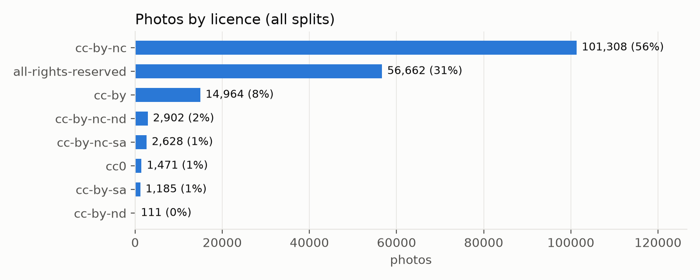
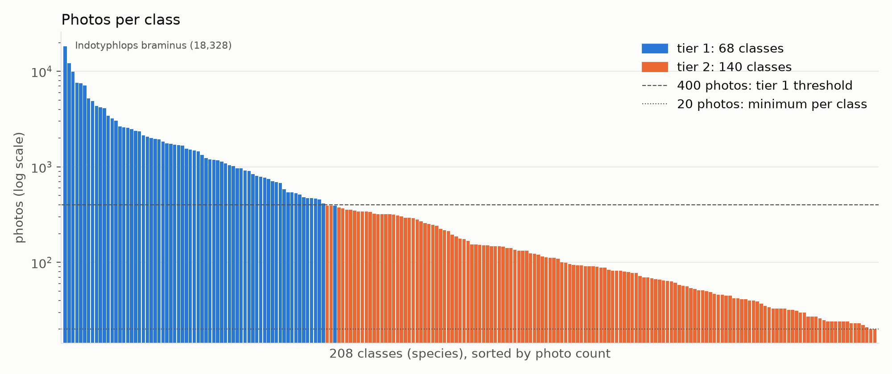
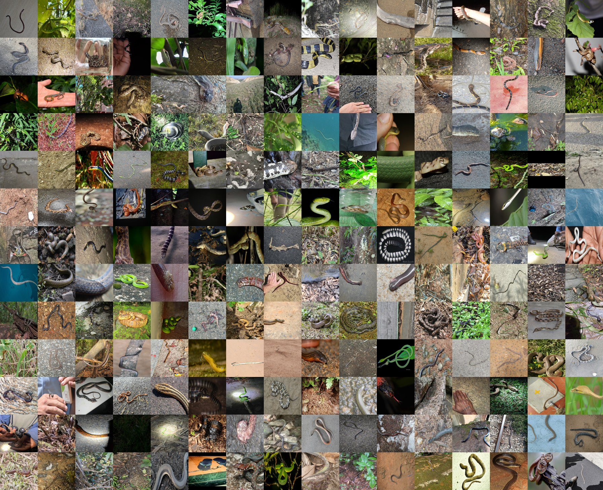
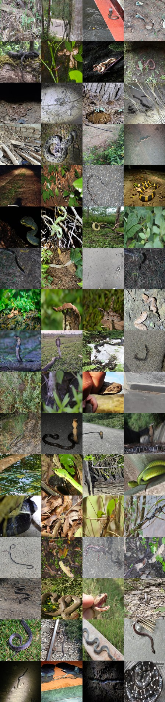
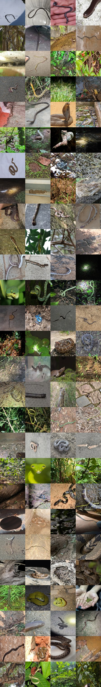
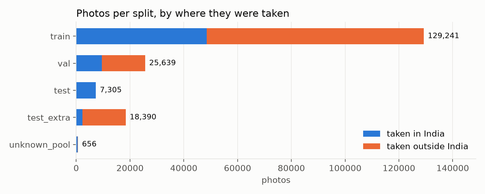

# Milestone 2: Dataset Preparation

Project: SerpentGuard AI, offline snake segmentation, classification and safety support<br>
Team: Group 5, DS and AI Lab Project. Team lead Jayesh Bansal; members Vikas, Puneet Bajaj and Manas Rastogi<br>
Date: 29 October 2026

## Summary

We built our dataset from iNaturalist research-grade observations: every photo, from anywhere in the world, of the 289 snake species recorded in India. After cleaning and duplicate removal, it holds **181,231 photos**: 180,575 in **208 classes** (species with at least 20 photos), plus 656 photos of 81 rarer species kept aside to test the "unknown" answer. Photos are split by photographer, so no photographer, observation or identical image appears in more than one of training, validation and test. The test set uses only photos taken in India and uploaded from 2022 onward.

| Item | Value |
|---|---|
| Source | iNaturalist research-grade observations, built 24 October 2026 |
| Species recorded in India | 289 |
| Photos in the final dataset | 181,231 (95,787 observations, 25,041 photographers) |
| Classes | 208: 68 tier-1 classes (at least 400 photos), 140 tier-2 classes (20 to 399) |
| WHO medically important classes | 17 (6 Category 1, 11 Category 2) |
| Unknown pool | 81 species, 656 photos, never used for training |
| Split (photos) | train 129,241 · validation 25,639 · test 7,305 · test_extra 18,390 |
| Processed dataset | Private Kaggle dataset `puneetbajajiitm/serpentguard-indian-snakes-processed` (section 7) |
| Rebuild | Notebooks 01 to 04 in [`notebooks/`](../../notebooks/README.md) |

## 1. Dataset selected

### 1.1 Choice of source

iNaturalist is the main source. Members of the public upload photos of animals they see, and other users identify the species. An observation becomes **research grade** when at least two people have identified it and more than two-thirds of them agree on the species. We use that community identification as the label.

We chose it for three reasons:

1. It covers Indian snakes far better than any other public image source we found: 36,557 research-grade observations in India across 289 species on 24 October 2026.
2. Each photo comes with an observer, a date, a location and a licence, which we need for grouped splits and for licence records.
3. The released global model we compare against (Bolon et al. 2022) was trained mostly on iNaturalist data from before 2022, so photos uploaded later give a fair test.

### 1.2 Sources considered

| Source | What it offers | Decision for this milestone |
|---|---|---|
| iNaturalist research-grade observations | Species labels, metadata and licence per photo for every Indian species | **Used** (all of section 2 onward) |
| India Biodiversity Portal (via GBIF) | About 1,800 CC BY photos of 180 Indian species | Not included: the portal answers scripted downloads with HTTP 403 |
| SnakeCLEF 2021 (global model's training data) | 2,904 Indian photos; 1,742 are iNaturalist copies, about 1,160 come from HerpMapper and Flickr | Deferred: attaching its 66 GB Kaggle mirror stops Kaggle kernels before they start; we will fetch only the needed files later |
| SnakeCLEF 2023 Kaggle mirror | 4,989 Indian photos of 146 species | Not used: all are iNaturalist copies, already in our data |
| Kaggle sets scraped from Google, blogs or Facebook (for example "Snake Dataset-India", "Giant Snake Data") | Extra photos, often venomous/non-venomous labels only | Not used: unclear copyright, no verified species labels, and a high risk of duplicating our test photos |
| Manna et al. 2026, OSF folder | 793 photos from Indian emergency departments | Not used: no species labels and no stated reuse terms. We may ask the authors for labels to build a real-world test set |
| Open Images V7, class `Snake` | Boxes and masks around generic snakes, no species | Planned for Milestone 3 to supervise the segmentation head |

### 1.3 Change from Milestone 1

The Milestone 1 plan used 27 species with at least 200 Creative Commons observations in India. The TA's review found that too narrow, since India has roughly 300 to 400 snake species. We widened the dataset in two ways:

- We include photos from outside India of species recorded in India. That brings in species that are rare in Indian records, such as the king cobra, the monocled cobra and the banded krait, all WHO-listed. Test photos stay Indian.
- We include photos under every licence and record each photo's licence (section 2.2).

The 27 Milestone 1 species are all present and are flagged as `m1_core27` in the metadata.

## 2. Source, licence and usage

### 2.1 How the raw data was collected

| Step | Detail |
|---|---|
| Species list | iNaturalist API `observations/species_counts`, place 6681 (India), taxon 85553 (snakes), research grade only. Queries use taxon ids, never names: a name search for "Naja naja" returned a damselfly |
| Observations | Every research-grade observation of each species, worldwide, paged by observation id |
| Photos | iNaturalist's `medium` size (at most 500 px on the long side). Creative Commons photos come from the iNaturalist open-data bucket; all-rights-reserved photos come from iNaturalist's own server, throttled to 4.5 GB per hour |
| Run | One Kaggle notebook, 150 minutes, 182,497 photos, 0 failed downloads, 24.5 GB |
| Checks | 30 random photos re-downloaded from Kaggle matched their SHA-1 and size (30/30); for 8 sampled species the observation count equalled iNaturalist's live total |

### 2.2 Licences

Each photo keeps the licence its photographer chose. The licence and the photographer's attribution are stored for every photo in `metadata.csv`.



| Licence | Photos | Share |
|---|---:|---:|
| CC BY-NC | 101,308 | 56% |
| All rights reserved | 56,662 | 31% |
| CC BY | 14,964 | 8% |
| CC BY-NC-ND | 2,902 | 2% |
| CC BY-NC-SA | 2,628 | 1% |
| CC0 | 1,471 | 1% |
| CC BY-SA | 1,185 | 1% |
| CC BY-ND | 111 | under 1% |

How we use the data:

- The datasets are **private** on Kaggle, shared only with team members and the course staff, and used only for this non-commercial course project.
- Images are never committed to this public repository. The repository holds code, class tables and reports.
- 69% of photos carry a Creative Commons licence. The `cc_licensed` column marks them, so a Creative Commons-only subset (124,569 photos) can be selected in one line if required.
- The WHO medical-importance labels come from WHO SEARO (2016), *Guidelines for the Management of Snakebites*, 2nd edition, India section, PDF pages 86 and 87.

## 3. Size, classes and metadata

### 3.1 From raw photos to classes

| Stage | Photos | Notes |
|---|---:|---|
| Raw download | 182,497 | 289 species, 96,187 observations |
| Removed: exact duplicates | 928 | same image bytes (SHA-1) more than once; one copy kept |
| Removed: duplicates with conflicting species | 30 | same image under two species; all copies removed |
| Removed: too small | 36 | under 5 KB, or shorter side under 100 px |
| **Clean** | **181,503** | |
| Removed: near-duplicates across splits | 272 | a validation or test photo whose perceptual hash matches an earlier split (164 validation, 33 test, 75 test_extra) |
| **Final** | **181,231** | |
| In the 208 classes | 180,575 | species with at least 20 clean photos |
| Unknown pool | 656 | 81 species with fewer than 20 photos |

### 3.2 Classes

A class is one species. Each class has four labels: species, genus (70 genera), family (iNaturalist taxonomy) and WHO category for India.

| Tier | Rule | Classes | Photos | Intended use |
|---|---|---:|---:|---|
| Tier 1 | at least 400 photos | 68 | 162,770 | full species classification |
| Tier 2 | 20 to 399 photos | 140 | 17,805 | few-shot classification, genus and danger fallback |
| Unknown pool | under 20 photos | 81 species | 656 | testing the "unknown" answer |



The data is long-tailed. The largest class, the Brahminy blind snake (*Indotyphlops braminus*), has 18,340 photos, many of them from outside India because the species has spread worldwide. Tier-2 classes average 127 photos.

**WHO medically important classes (17):**

| Species | WHO category (India) | Tier | Train | Val | Test | Test extra |
|---|---|---|---:|---:|---:|---:|
| *Naja naja*, spectacled cobra | 1 | 1 | 2,955 | 586 | 385 | 204 |
| *Craspedocephalus malabaricus*, Malabar pit viper | 2 | 1 | 1,892 | 377 | 330 | 62 |
| *Echis carinatus*, saw-scaled viper | 1 | 1 | 1,766 | 354 | 113 | 240 |
| *Daboia russelii*, Russell's viper | 1 | 1 | 1,704 | 338 | 225 | 116 |
| *Bungarus fasciatus*, banded krait | 2 | 1 | 1,392 | 277 | 21 | 257 |
| *Craspedocephalus gramineus*, bamboo pit viper | 2 | 1 | 1,206 | 238 | 339 | 64 |
| *Bungarus caeruleus*, common krait | 1 | 1 | 1,253 | 251 | 192 | 59 |
| *Hypnale hypnale*, hump-nosed pit viper | 1 | 1 | 1,206 | 241 | 176 | 65 |
| *Naja kaouthia*, monocled cobra | 1 | 1 | 858 | 172 | 24 | 147 |
| *Macrovipera lebetinus*, Levantine viper | 2 | 1 | 883 | 151 | 0 | 147 |
| *Ophiophagus hannah*, king cobra | 2 | 1 | 692 | 138 | 15 | 124 |
| *Trimeresurus erythrurus*, red-tailed pit viper | 2 | 2 | 244 | 49 | 30 | 19 |
| *Ophiophagus kaalinga*, Western Ghats king cobra | 2 | 2 | 111 | 22 | 18 | 4 |
| *Bungarus niger*, black krait | 2 | 2 | 86 | 16 | 12 | 6 |
| *Naja oxiana*, Oxus cobra | 2 | 2 | 41 | 8 | 0 | 8 |
| *Bungarus walli*, Wall's krait | 2 | 2 | 15 | 9 | 0 | 6 |
| *Bungarus sindanus*, Sind krait | 2 | 2 | 17 | 2 | 2 | 2 |

*Ophiophagus kaalinga* was split from *O. hannah* in 2024, after the WHO guideline, so it takes the king cobra's Category 2. The full table for all 208 classes is [`data/classes.csv`](../../data/classes.csv).

### 3.3 Image characteristics

| Property | Value |
|---|---|
| Format | JPEG, RGB |
| Size | long side 500 px for 99.7% of photos; median 500 × 375 px; shorter side at least 100 px |
| File size | median 125 KB; 24.4 GB in total |
| Photos per observation | 1.89 on average |
| Taken in India | 37.7% of photos |
| Observation dates | 1968 to 2026; 87% from 2020 onward |
| Obscured coordinates | 18.2% of photos (iNaturalist hides the exact location of sensitive species and of observers who ask) |

### 3.4 Metadata

`metadata.csv` has one row per photo:

| Column | Meaning |
|---|---|
| `path` | location inside the processed dataset, `<split>/<species>/<file>.jpg` |
| `split` | train, val, test, test_extra or unknown_pool |
| `species`, `genus`, `family` | labels |
| `who_category` | 1, 2 or not_listed (WHO SEARO 2016, India) |
| `tier`, `m1_core27` | class tier, and whether the species was in the Milestone 1 list |
| `obs_id`, `photo_id`, `photo_position` | iNaturalist observation, photo, and order within the observation |
| `observer_id` | iNaturalist user id, used for grouping |
| `observed_on`, `created_at` | date taken and date uploaded |
| `in_india`, `latitude`, `longitude`, `obscured` | place information |
| `license`, `cc_licensed`, `attribution`, `url` | licence and credit for each photo |
| `width`, `height`, `bytes`, `sha1`, `phash` | image size and fingerprints used for deduplication |

### 3.5 Distribution of key attributes

| Attribute | Distribution (photos in the 208 classes, 180,575) |
|---|---|
| Family | Colubridae 91,152 · Viperidae 22,624 · Typhlopidae 18,898 · Elapidae 18,528 · Pythonidae 9,874 · Psammodynastidae 7,086 · 7 smaller families 12,413 |
| WHO category (India) | Category 1: 13,630 (7.5%) · Category 2: 9,332 (5.2%) · not listed: 157,613 (87.3%) |
| Where taken | India 37.7% · outside India 62.3% (all splits; the test set is India only) |
| Year observed (all 181,231 photos) | up to 2015: 8,214 · 2016 to 2019: 15,195 · 2020 to 2021: 20,636 · 2022 to 2023: 38,268 · 2024 to 2026: 98,918 |
| Photo position | 52.8% are the first photo of their observation; the rest are later photos, which more often show habitat, a hand or a detail |

The class distribution is long-tailed (section 3.2), so the planned training uses class-balanced sampling or loss weighting, and the headline metric is macro-F1, which weights every class equally.

### 3.6 Data quality

| Check | What we found | How it is handled |
|---|---|---|
| Missing values | Every photo has its species, licence, attribution, observer, dates, size and checksum. Coordinates are missing for 1,488 photos (0.8%) and obscured by iNaturalist for 33,061 (18%) | Location is optional (only used by the planned state prior), so these photos stay |
| Inconsistent labels | 30 photos had identical bytes under two different species | Removed (section 3.1) |
| Taxonomic level | 8,578 photos were identified to a subspecies, for example *Echis carinatus carinatus* | Each species was queried by taxon id, which includes its subspecies, so they carry the species label; `record_taxon` keeps the original identification |
| Taxonomic changes | Renamed genera (*Xenochrophis* to *Fowlea*, *Trimeresurus* to *Craspedocephalus*) and the 2024 king cobra split | Labels follow iNaturalist's taxonomy on 24 October 2026, by taxon id |
| Duplicates | 928 exact duplicates; 272 near-duplicates across splits | Removed (sections 3.1 and 5) |
| Label noise | Research grade applies to the observation, not each photo. In the 500-photo segmentation pilot, roughly 2% of photos did not show a live snake (shed skins, another animal, footwear) | Kept for now; `photo_position` marks later photos; a stratified hand-check of 200 photos is planned for Milestone 3; mask quality flags keep non-snake photos out of mask training |
| Image quality | 36 photos too small or too low in resolution; every remaining photo decodes and matches its SHA-1 | Removed; verified during processing |

### 3.7 Is the dataset adequate?

- **Species classification:** adequate for the 68 tier-1 classes, which have at least 400 photos each (enough to fine-tune a pretrained backbone) and an Indian test set for 57 of them. The 140 tier-2 classes are too small for standard training, so the plan uses few-shot methods for them and falls back to genus and danger level.
- **Dangerous species:** 17 WHO-listed classes with 22,962 photos (12.7% of the classes' photos). Some have small Indian test sets (king cobra 15, banded krait 21, monocled cobra 24), so their results will carry wide bootstrap intervals and are also reported on `test_extra`.
- **Real-world conditions:** iNaturalist photos are mostly still, well-framed and taken in daylight by enthusiasts. Real use means hurried phone photos and video, at night and with partial views. Augmentation and the planned synthetic and re-filmed video clips address this gap, and an emergency-department photo set (Manna et al. 2026) would test it if the authors agree.
- **Segmentation:** there are no ground-truth snake masks, so masks come from SAM 2.1 pseudo-labels (section 9), with Open Images masks as a supplement.
- **Video:** there is no public species-labelled snake video, so video is used for evaluation only, through synthetic clips.

### 3.8 Augmentation, supplementary and synthetic data

- **Augmentation** (applied in the data loader during training, not stored): random resized crops, horizontal flips, small rotations, brightness and contrast changes, blur, JPEG compression and partial occlusion. We avoid colour or hue shifts strong enough to change banding or colour patterns, which are diagnostic for several lookalike pairs.
- **Supplementary data:** the HerpMapper and Flickr photos of Indian species from SnakeCLEF 2021 (about 1,160 Indian photos, to be fetched file by file), Open Images V7 snake masks for segmentation pretraining, and the Manna et al. 2026 emergency-department photos as a real-world test set if the authors grant labels and reuse.
- **Synthetic data:** none in this milestone. The synthetic video clips from the Milestone 1 plan (camera motion, blur, low light and occlusion applied to test photos, with every parameter seeded and logged) will be generated for evaluation only, from test photos, in Milestone 5. The SAM masks are pseudo-labels on real photos, not synthetic images.

### 3.9 Labels, annotations and how the datasets connect

| Label or annotation | Source | Quality check |
|---|---|---|
| Species | iNaturalist research grade: at least two identifiers, more than two-thirds agreeing | Conflicting duplicates removed; subspecies rolled up by taxon id; planned 200-photo hand-check |
| Genus and family | iNaturalist taxonomy of each species | Taken from the taxonomy tree, not typed by hand |
| WHO category | WHO SEARO 2016, India list | 17 of the 20 listed species are classes. *Naja sagittifera* (Andaman cobra) has only 7 photos and sits in the unknown pool; *Trimeresurus albolabris* and *T. purpureomaculatus* have no research-grade photos under those names, likely because of later taxonomic splits. *Ophiophagus kaalinga* inherits the king cobra's category |
| Snake mask | Grounding DINO plus SAM 2.1 pseudo-labels, training photos only | Quality flags; flagged masks go to a hand review |

Every table shares one key. `metadata.csv` has one row per photo with its `path` and `photo_id`. A mask file has the same name as its photo. `classes.csv` maps each species to its `class_id`. The WHO category and taxonomy join on species. Masks are made only for training photos, so segmentation supervision never touches validation or test photos. Open Images is used only to pretrain the segmentation head and never enters the species splits.

## 4. Sample images

Two photos from the dataset show one of the lookalike pairs the model must separate: the spectacled cobra is WHO Category 1, and the oriental rat snake is not listed.

| Spectacled cobra (*Naja naja*) | Oriental rat snake (*Ptyas mucosa*) |
|---|---|
|  |  |
| © Chayant Gonsalves, CC BY, [iNaturalist 84964394](https://www.inaturalist.org/observations/84964394) | © Surabhi Srivastava, CC BY, [iNaturalist 212098553](https://www.inaturalist.org/observations/212098553) |

The grids below are random training photos (fixed seed), drawn only from photos whose licence allows sharing a resized copy with credit: CC0, CC BY, CC BY-SA, CC BY-NC and CC BY-NC-SA. Each grid has an `_attribution.csv` in `assets/` listing every tile's species, photographer, licence and source. Grids drawn from all photos, including all-rights-reserved ones, stay in the private Kaggle dataset (`figures/`).

**One photo per class** (row by row, largest class first; [credits and order](assets/grid_all_classes_attribution.csv)):



**WHO Category 1 and 2 species, four photos each** (one row per species; [credits and order](assets/grid_who_listed_attribution.csv)) and **Milestone 1 core species, four photos each** ([credits and order](assets/grid_core27_attribution.csv)):

| WHO-listed species (17 rows) | Milestone 1 core species (27 rows) |
|---|---|
|  |  |

A manual check of downloaded photos found the variety the model will face: snakes held in a hand, specimens beside a ruler, night photos with the snake small in the frame, and photographers' watermarks. Research grade applies to the observation, not to each photo, so a photo can show a shed skin or the habitat instead of the snake.

## 5. Cleaning and preprocessing

| Step | What it does | Why |
|---|---|---|
| Remove tiny files | drops photos under 5 KB or with a shorter side under 100 px | they carry too little detail for scale and pattern features |
| Remove conflicting duplicates | drops every copy of an image that appears under two species | the label cannot be trusted |
| Remove exact duplicates | keeps one copy of byte-identical photos, preferring the Indian one | one photo must not appear twice or in two splits |
| Remove near-duplicates across splits | drops a validation or test photo whose perceptual hash already appears in an earlier split | resized or recompressed copies would inflate test scores |
| Verify every file | checks each photo's SHA-1 against the download manifest | catches corruption between the download and the processed copy |
| Keep the original resolution | photos stay at iNaturalist's `medium` size | the encoders compared in Milestone 3 need different input sizes (224, 256 or 384 px), so resizing, normalisation and augmentation happen in each model's data loader |
| Attach labels | species, genus, family, WHO category, tier | the planned model has species, genus and danger heads |

The class, split and licence figures in this report come from `metadata.csv`. The exploratory analysis and the preprocessing notebooks, with their visualisations, are in section 5.1.

### 5.1 Exploratory data analysis

*(To be added by Vikas and Manas.)*

## 6. Train, validation and test split

### 6.1 Strategy

1. **Group by photographer.** We use scikit-learn's `StratifiedGroupKFold` with 7 folds and seed 42, grouped by iNaturalist user and stratified by species. Fold 0 is the test fold, fold 1 is validation, and folds 2 to 6 are training (roughly 71/14/14). One photographer often posts the same individual snake, the same camera and the same place many times, so photos from one photographer must not sit on both sides of the split. Grouping by photographer also keeps every photo of an observation together.
2. **Indian test set.** Within the test fold, `test` keeps photos taken in India and uploaded on or after 1 January 2022. The project is for Indian users, and the 2022 cutoff means the published global model, trained on SnakeCLEF 2021 data, has never seen these photos.
3. **Secondary test set.** The rest of the test fold (photos taken outside India, or uploaded before 2022) becomes `test_extra`. It is never moved into training, so no photographer crosses splits. It serves species with too few Indian test photos and lets us measure how well photos from abroad transfer.
4. **Unknown pool.** The 81 species with fewer than 20 photos are never trained on. They test whether the model says "unknown" for a snake outside its classes.

### 6.2 Split sizes

| Split | Photos | Observations | Photographers | Taken in India |
|---|---:|---:|---:|---:|
| train | 129,241 | 68,122 | 17,856 | 48,581 |
| val | 25,639 | 13,486 | 3,583 | 9,525 |
| test | 7,305 | 3,972 | 767 | 7,305 |
| test_extra | 18,390 | 9,853 | 2,921 | 2,331 |
| unknown_pool | 656 | 354 | 231 | 550 |



For the 27 Milestone 1 species, the Indian test set has between 58 and 707 photos per species (median 164).

### 6.3 Leakage checks

| Check (between train, validation and the test fold) | Overlaps |
|---|---:|
| Photographers in more than one split | 0 |
| Observations in more than one split | 0 |
| Identical images (SHA-1) in more than one split | 0 |
| Near-identical images (perceptual hash) in more than one split | 0 (272 removed) |

### 6.4 Limitations of the split

- 28 classes have no photo in the Indian test set (11 tier-1, 17 tier-2), and one has no validation photo. Most are species that are common elsewhere but rarely photographed in India, such as *Ahaetulla prasina*. They are evaluated on `test_extra`. Because those splits lack some species folders, class ids must come from `classes.csv` (section 7).
- Some dangerous species have small Indian test sets: the king cobra has 15, the banded krait 21 and the monocled cobra 24. Their per-class results will carry wide confidence intervals, so we will report bootstrap intervals.
- `test` is smaller than a plain 15% split (7,305 photos) because it keeps only recent Indian photos. We accept that trade for a test set that matches the intended users and is fair to the published baseline.

## 7. Folder structure and hosted dataset

```text
serpentguard-indian-snakes-processed/
├── data/
│   ├── train/<species>/<source>_<photo_id>.jpg
│   ├── val/<species>/...
│   ├── test/<species>/...
│   ├── test_extra/<species>/...
│   └── unknown_pool/<species>/...
├── metadata.csv              one row per photo (section 3.4)
├── classes.csv               one row per class with per-split counts
├── processing_report.json    counts, removals and leakage checks
├── figures/                  sample image grids
└── README.md
```

**Class ids come from `classes.csv`, never from the folders.** 28 species have no photos in `test/` and one has none in `val/` (section 6.4), so those splits have fewer species folders than `train/`. Loaders that number classes by the folders they find, such as plain `torchvision.datasets.ImageFolder` or Keras `image_dataset_from_directory`, would give one species different numbers in different splits and silently mislabel every photo after the first missing folder. `classes.csv` assigns one `class_id` per species, used for every split, and `metadata.csv` gives each photo's `path` and `species`, together with genus, family and WHO labels for the multi-task heads. [`notebooks/load_dataset_example.ipynb`](../../notebooks/load_dataset_example.ipynb) includes a dataset class that loads any split this way and prints the number of species folders per split.

| Dataset on Kaggle (private) | Contents |
|---|---|
| [`puneetbajajiitm/serpentguard-indian-snakes-processed`](https://www.kaggle.com/datasets/puneetbajajiitm/serpentguard-indian-snakes-processed) | the processed dataset described here |
| [`puneetbajajiitm/serpentguard-indian-snakes`](https://www.kaggle.com/datasets/puneetbajajiitm/serpentguard-indian-snakes) | raw download with the full manifest |
| [`puneetbajajiitm/serpentguard-m2-splits`](https://www.kaggle.com/datasets/puneetbajajiitm/serpentguard-m2-splits) | split table, class table and excluded photos |

The datasets are private. All four team members have access, and we add the course staff as collaborators on request so the links and the notebook open for them. The notebook attaches the datasets by handle with `kagglehub.dataset_download`, so nothing has to be added by hand.

## 8. Reproducibility

The pipeline is a chain of Kaggle notebooks in [`notebooks/`](../../notebooks/README.md). Each one attaches its inputs by handle, does one job, and saves its output as a private dataset, which the next notebook reads. Any step can be rerun on its own.

| Notebook | Reads | Saves | Time |
|---|---|---|---|
| [`01_build_raw_dataset`](../../notebooks/01_build_raw_dataset.ipynb) | iNaturalist API | `serpentguard-indian-snakes` | about 2.5 h on CPU |
| [`02_clean_and_split`](../../notebooks/02_clean_and_split.ipynb) | 01 | `serpentguard-m2-splits` | about 3 min on CPU |
| [`03_process_dataset`](../../notebooks/03_process_dataset.ipynb) | 01 and 02 | `serpentguard-indian-snakes-processed` | about 35 min on CPU |
| [`04_sam_masks`](../../notebooks/04_sam_masks.ipynb) | 01 and 02 | snake masks (section 9) | about 1 h per shard on two T4 GPUs |
| [`load_dataset_example`](../../notebooks/load_dataset_example.ipynb) | 02 and 03 | nothing; the starting point for EDA and training notebooks | about a minute |

Every random choice uses a fixed seed (42 for splits, 7 for samples). The cleaning steps, labels and class list reproduce exactly. The fold each photographer lands in also depends on the scikit-learn version, because `StratifiedGroupKFold` shuffling differs between releases:

- With scikit-learn 1.9.1, which made our split, rerunning the split step matched all 181,503 rows on split, path and every label.
- Kaggle's default environment (scikit-learn 1.6.1) gave a different fold assignment of the same size and quality (train 131,238, test 7,662), again with zero leakage, agreeing with ours for 56.3% of photos.

Notebook 02 therefore installs scikit-learn 1.9.1 before it splits, and checks its result against the published `splits.csv`, which stays the reference split. Run on Kaggle on 29 October 2026, it reproduced the published split for 100% of photos. Using that split on Kaggle on 29 October 2026, the processing step rebuilt the processed dataset independently of our first processing run and matched it exactly: 181,231 photos kept, 272 near-duplicates removed, 0 SHA-1 mismatches and 0 leakage on all four checks. iNaturalist keeps growing, so a fresh run of notebook 01 downloads more photos than ours. Our build date is 24 October 2026.

## 9. Known issues and next steps

- **Segmentation masks.** [`notebooks/04_sam_masks.ipynb`](../../notebooks/04_sam_masks.ipynb) makes snake masks for training photos with Grounding DINO (prompt "a snake.") and SAM 2.1. SAM 3 accepts text prompts directly, but its weights are gated behind a manual access request, so we use the open SAM 2.1.
  - The 500-photo pilot went through four versions. The first showed three failure types: hands included when someone holds the snake, background leaking in when several boxes were merged, and photos that show something other than a snake (shed skins, another animal).
  - The current version keeps one snake box, subtracts hands and gloves found by a separate detector pass, and flags doubtful masks (low detector score, a mask filling too little or too much of its box or photo). On the pilot it found a snake in 486 of 500 photos, flagged 95 for review, and ran at 0.39 seconds per photo on two T4 GPUs.
  - The full run (up to 200 training photos per class, 25,478 photos) is running in three shards across team accounts. The team will hand-check the flagged masks (`review.csv`) in Milestone 3, before the masks train the segmentation head.
- **Label noise.** Research grade applies to observations, so some photos show habitat, shed skin or a second animal. We will hand-check a stratified sample of 200 photos in Milestone 3 and report the error rate.
- **Taxonomic change.** Species splits after older records (for example the king cobra in 2024) mean some older photos may sit under the parent species.
- **Sources not yet included.** The HerpMapper and Flickr photos from SnakeCLEF 2021, and the India Biodiversity Portal, as explained in section 1.2.

## References

1. iNaturalist API v1, [documentation](https://api.inaturalist.org/v1/docs/), queried 24 October 2026 (place 6681 = India; taxon 85553 = Serpentes; research grade).
2. iNaturalist, [open-data photo files and attribution](https://github.com/inaturalist/inaturalist-open-data/blob/main/README.md).
3. Bolon I. et al. (2022). [An artificial intelligence model to identify snakes from across the world](https://journals.plos.org/plosntds/article?id=10.1371/journal.pntd.0010647). *PLOS Neglected Tropical Diseases* 16(8): e0010647.
4. World Health Organization, Regional Office for South-East Asia (2016). [Guidelines for the Management of Snakebites, 2nd edition](https://cdn.who.int/media/docs/default-source/searo/india/health-topic-pdf/who-guidance-on-management-of-snakebites.pdf). India categories on PDF pages 86 and 87.
5. Picek L. et al. (2021). [SnakeCLEF 2021 challenge](https://www.aicrowd.com/challenges/snakeclef2021-snake-species-identification-challenge).
6. Manna I. I. A. et al. (2026). [Indian venomous snake classification with explainable AI](https://doi.org/10.1371/journal.pntd.0014147). *PLOS Neglected Tropical Diseases* 20(6): e0014147.
7. Google, [Open Images V7](https://storage.googleapis.com/openimages/web/download_v7.html).
8. Pedregosa F. et al. (2011). [Scikit-learn: Machine Learning in Python](https://jmlr.org/papers/v12/pedregosa11a.html). *JMLR* 12: 2825-2830 (`StratifiedGroupKFold`).

<div style="page-break-before: always"></div>

# Team review and acknowledgment

**This is the final page of the report. Each team member must complete and sign one row before submission.** By signing, each member confirms that they have reviewed the submitted document, understand its contents, and agree with the submission.

| Team member name | Roll Number | Signature / acknowledgment | Date |
|---|---|---|---|
| Jayesh Bansal | 24f100185 | | |
| Vikas | 23f3001800 | | |
| Puneet Bajaj | 23f3002416 | | |
| Manas Rastogi | 22f3001477 | | |
